

  <picture>
    <source media="(prefers-color-scheme: dark)" srcset="docs/assets/logo-dark.png">
    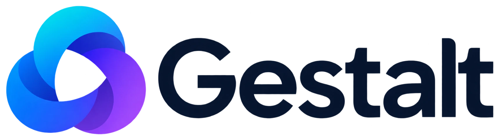
  </picture>

A self-hosted IRC bouncer with a compact web client. The bouncer keeps you connected to your IRC networks and keeps the history; the client runs in any browser, on a phone or a desktop, and adds direct chat, file transfer, voice and plugins. A gestalt is a whole that is more than its parts: IRC, kept alive by the bouncer, seen through one client, with the people on it able to reach each other directly.

The server is Go and the client is Svelte. Any other IRC client can use the same bouncer.

## Screenshots

**Managing servers.** The bar on the left has one icon per server and a **+** that always adds another. Click the server you are on for its menu: edit, switch off (it stays in the bar, dimmed, so you can switch it back on) or remove.

  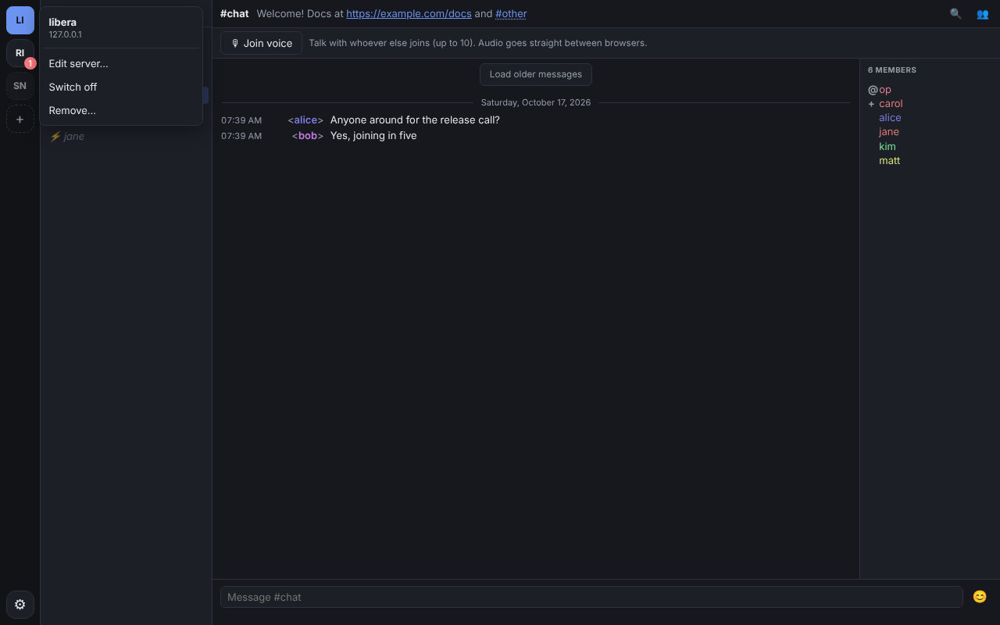

The server dialog has the server's details first, then who you are (with alternative nicks), how you log in, what to do after connecting, and the highlight words and notifications for that server only.

  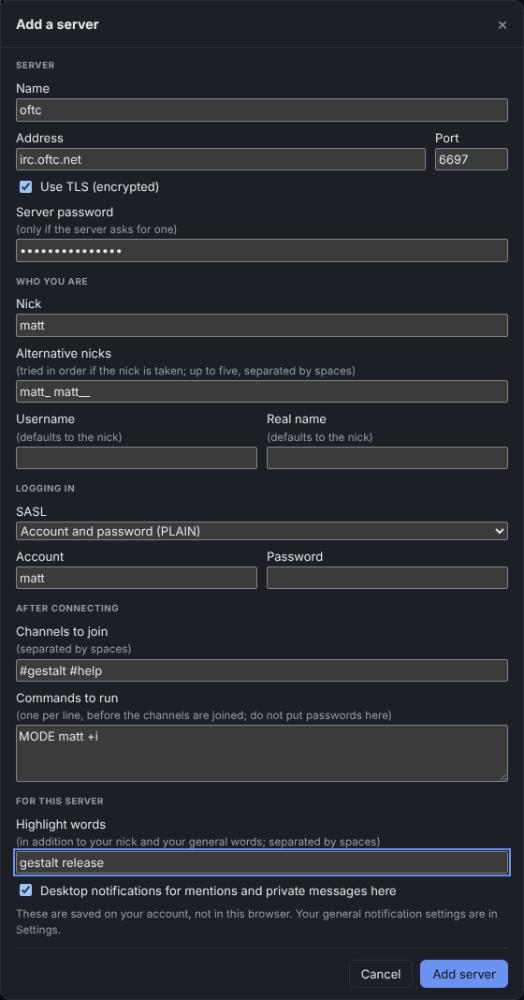

**Pictures and gifs in the conversation**, one after another: a picture link, a Giphy page, a plain gif link and an imgur page. Your browser never contacts those sites; the bouncer fetches them.

  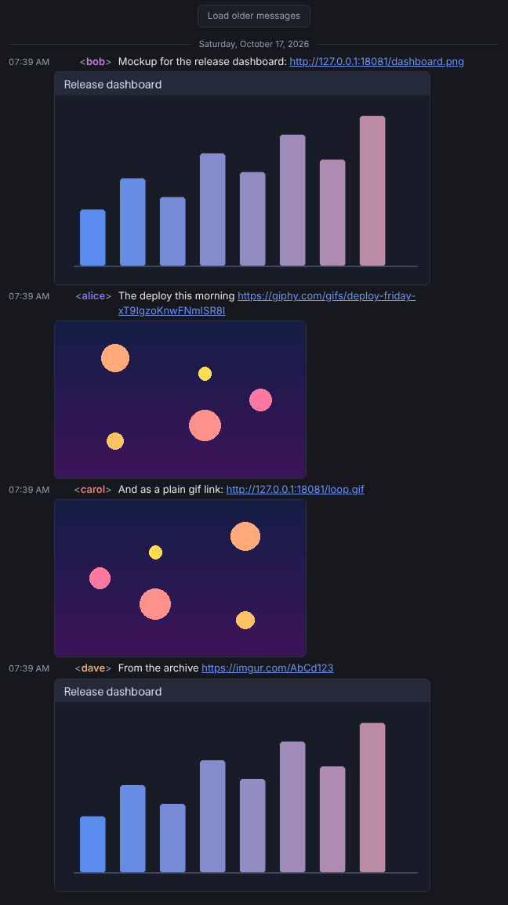

**Sound, video and links**: an audio player for a sound file, a card for a YouTube link (nothing loads from YouTube until you press play), and a preview card for any page.

  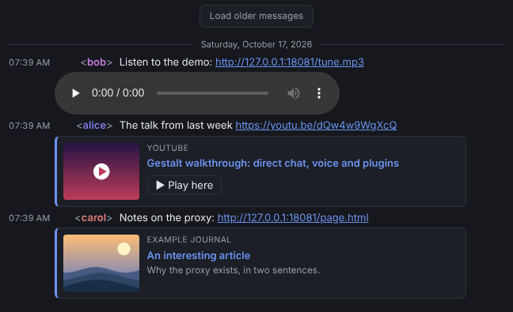

**Direct chat** between two browsers, with file transfer. The safety code and certificates stay out of sight until you press Verify.

  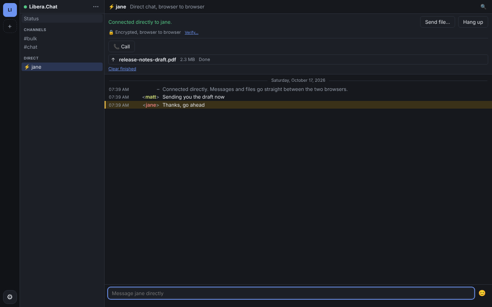

**Settings**, with a tab for each kind of thing: General, Appearance, Notifications, Highlights, Media and Plugins.

  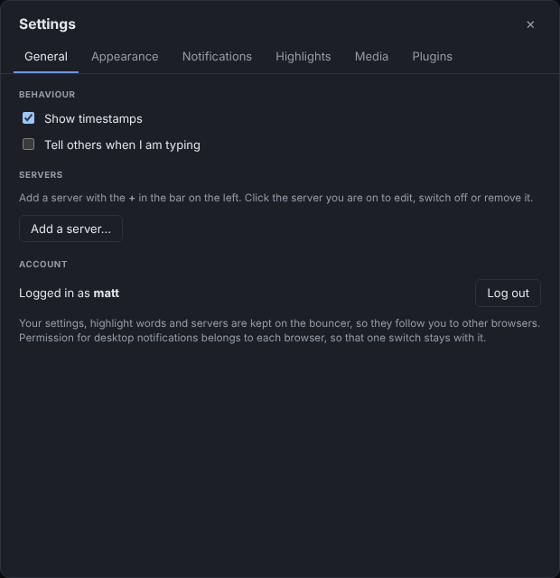
  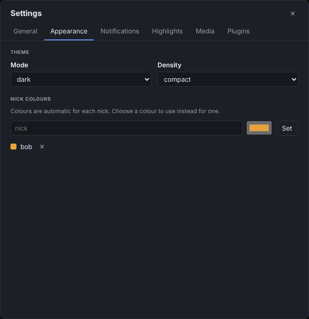
  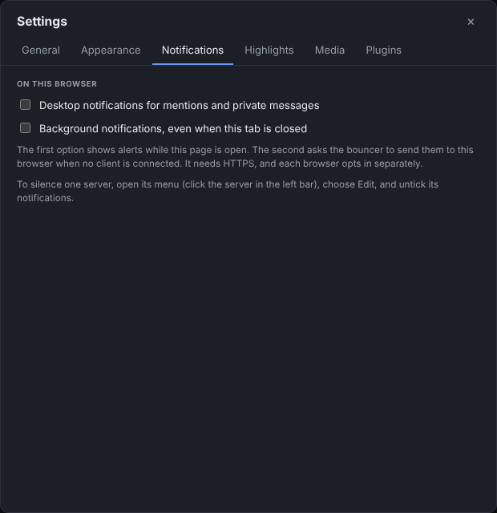

  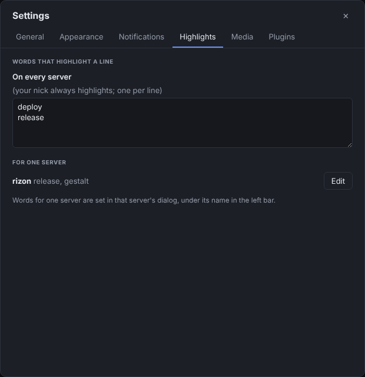
  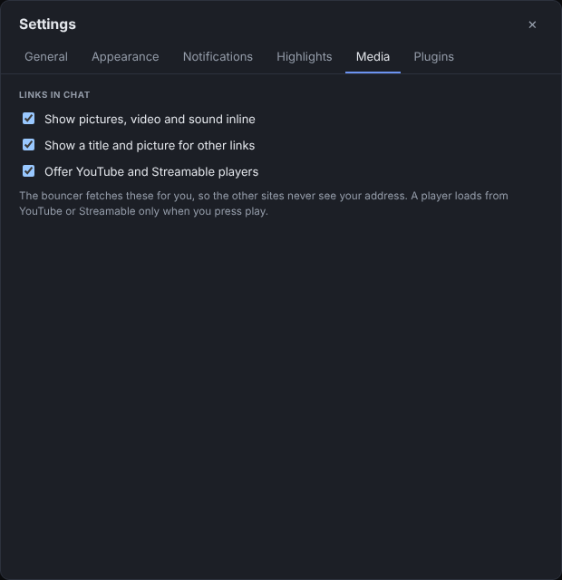
  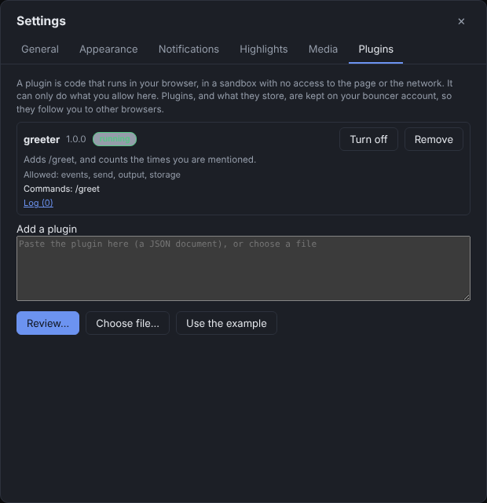

## Try it
You need Docker. This runs the bouncer and web client on your own machine:

    docker build -t gestalt .
    docker run -d --name gestalt -p 127.0.0.1:8080:8080 -v gestalt-data:/data gestalt
    echo 'a-long-password' | docker exec -i gestalt bouncer user add alice

Open <http://localhost:8080>, log in as `alice`, and press **Add a server** (Libera is `irc.libera.chat`, port 6697, TLS). The first start creates the database and secret key in the `gestalt-data` volume. Back that volume up: the key protects your saved passwords.

## Run it on a server
`docker-compose.yml` runs the whole stack: the bouncer and web client, [Caddy](https://caddyserver.com) for HTTPS (it gets and renews the certificate by itself), and [coturn](https://github.com/coturn/coturn) so that direct chat, file transfer and voice work between people behind NATs.

    cp .env.example .env            # set DOMAIN, and PUBLIC_IP if the server is behind NAT
    docker compose up -d
    echo 'a-long-password' | docker compose exec -T bouncer bouncer user add alice

Point `DOMAIN` at the server first. Open these ports in the firewall:

| Port | Used by | For |
|---|---|---|
| 80/tcp | Caddy | the certificate challenge, and the redirect to HTTPS |
| 443/tcp and 443/udp | Caddy | the web client (udp is HTTP/3) |
| 3478/udp and 3478/tcp | coturn | STUN and TURN |
| 49152-49252/udp | coturn | the relay range for media that cannot go direct |
| 5349/tcp | coturn | TURN over TLS, once you give it a certificate (optional) |

The bouncer's own port, 8080, is never published. See **[deploy/README.md](deploy/README.md)** for what the stack does, backing up, and what has and has not been tested.

## Features
- **Many servers, one login.** Each server has its own icon in the left bar, with channels, queries and a status window. Unread counts are grey, mentions are coloured, and the tab title shows the total. The **+** adds a server; click the one you are on to edit, switch off or remove it. A server can have a server password, alternative nicks (tried in order when the first is taken), SASL PLAIN or SCRAM or a NickServ password, channels to join, and commands to run after connecting, plus highlight words and notifications of its own. A server with a self-signed certificate, or one from a private authority, can be accepted with one switch: the bouncer remembers the first certificate it sees and refuses a different one later.
- **Always connected.** Close the browser and the bouncer stays on IRC. When you come back you get the messages you missed, and older ones by scrolling up (`CHATHISTORY`). The list draws only the rows near the view, so a channel with thousands of lines stays light: ten channels of 2000 messages each use about 16 MB in the browser.
- **Your settings follow you.** Reading a channel on your laptop clears it on your phone. Preferences, highlight words, each server's settings and your installed plugins (with what they store) are kept on the bouncer, so a new browser has them as soon as you log in. The one exception is permission for desktop notifications, which each browser grants for itself.
- **Notifications.** Mentions and private messages raise a desktop notification while the page is open. With Web Push, the bouncer notifies your browser even when the tab is closed and no client is connected.
- **Inline media.** Pictures (PNG, JPG, GIF, WEBP, AVIF, plus imgur and Giphy links) and video (MP4, WEBM, imgur GIFV) show in the chat, and sound files (MP3, OGG, OPUS, WAV, FLAC, M4A) get a player. Other links get a title and a picture. YouTube and Streamable show a card, and nothing loads from them until you press play. Your browser never contacts the linked site: the bouncer fetches it, so the site never sees your address. Each kind can be turned off.
- **Direct chat and file transfer.** `/direct NICK` asks someone to connect browser to browser over WebRTC. Nothing is connected until they accept. Chat and files then go straight between you, are not stored anywhere, and both sides can open a safety code to compare over another channel (**Verify**), so nobody in between, including the IRC server and the bouncer, can alter the connection unnoticed. Files are accepted one by one and checked against a SHA-256.
- **Voice.** Press **Join voice** in any channel to talk with up to ten people at once, with no media server: everyone connects to everyone. You see who is speaking, can mute, and set each person's volume. `/call NICK` rings one person privately.
- **Plugins.** Aliases, event hooks, timers and storage, written in JavaScript, run in a sandbox and limited to the permissions you grant. See [docs/PLUGINS.md](docs/PLUGINS.md).
- **Replies, reactions, typing.** Reply to a message, react with emoji, delete your own messages, and see who is typing (off until you turn it on). Away members are dimmed.
- **Commands.** Every IRC command works, and `/help` lists the built-in ones. Anything the client does not recognise is sent to the server as it is.
- **Nick colours.** Automatic per nick, with overrides in Settings. Your nick and any highlight words colour the line and raise a badge.
- **Themes.** Light, dark or follow the system, in compact or comfortable density.
- **Emoji picker.** The smiley beside the input, or Ctrl+E: a search box, recently used, and groups.
- **Keyboard.** Ctrl+K jumps to any channel on any network. Ctrl+F searches the messages of the channel you are in (`from:nick` narrows it to one person). Alt+A goes to the next unread, mentions first. Alt+Up and Alt+Down switch buffers. Tab completes nicks, channels and commands, and Up and Down recall what you typed. A button takes you back to the latest message when you have scrolled up.
- **Installable.** A browser can install it as an app on a phone or desktop. It needs the bouncer, so there is no offline mode.

## Plugins
A plugin is one JSON document, pasted into **Settings, Plugins**; it is kept on your account and follows you to other browsers. You see what it asks for and can untick any permission before it is installed. This one adds `/greet`:

    {
      "name": "greeter", "version": "1.0.0", "description": "Adds /greet.",
      "permissions": ["send"],
      "source": "irc.alias('greet', function (args, ctx) { irc.send('Hello, ' + (args[0] || ctx.nick) + '!', ctx.buffer) })"
    }

Plugins can react to messages, joins, parts, kicks, nick changes, topics and more, add their own commands, use timers and keep data. They cannot reach the network or the page, and cannot send commands that act on your browser or ask for passwords. **[Plugin guide and API reference](docs/PLUGINS.md)**

## Use other IRC clients
The bouncer speaks IRCv3 to clients, and the web client is one of them. An IRCv3 client such as HexChat or WeeChat can log in as `user/network` with SASL PLAIN, get the history it missed, and share one network connection with the web client. This is tested with the project's own scripted clients and a real Ergo server, not yet with those programs themselves. **[docs/SERVER.md](docs/SERVER.md)** lists the capabilities offered and the ones deliberately not.

## Security
IRC text is never rendered as HTML, and the page has a strict content security policy. Passwords are hashed with argon2id, saved network passwords are encrypted, and the bouncer fetches links for you but refuses to reach private addresses. Plugins run in a sandbox that cannot connect anywhere, and the browser tests try to get out of it. Dependencies are scanned daily, and the code is scanned with CodeQL. To report a problem privately, and to see what is and is not covered, read **[SECURITY.md](SECURITY.md)**.

## Roadmap
Not built yet:
- **Touch actions.** Reply, react and delete appear when you hover a message, so a touch screen cannot reach them yet.
- **Voice extras.** Push-to-talk and joining a room listen-only.
- **Plugin dialogs, and plugins that run on the server.**
- **Typing `:smile:` shortcodes** in the emoji picker, and a fuller emoji set than the ~380 in it.
- **Multiline messages** (`draft/multiline`).
- **DCC.** Direct chat and file transfer use WebRTC, so people on other IRC clients cannot be sent files this way.

Reactions, replies and typing need the IRC network to support message tags.

## Build from source
See **[docs/BUILDING.md](docs/BUILDING.md)** for requirements, running it without Docker, the admin commands and the tests, and [DESIGN.md](DESIGN.md) for how it is put together and why.

    docker build -t gestalt .

The server's Go module is still called `gestalt/server`, and the binary `bouncer`.
